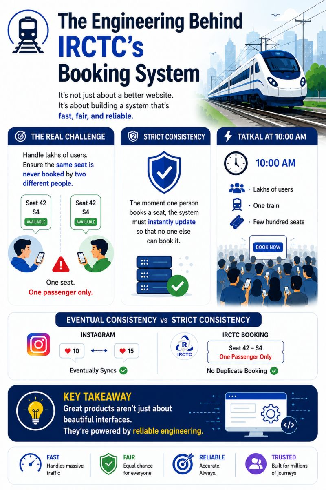
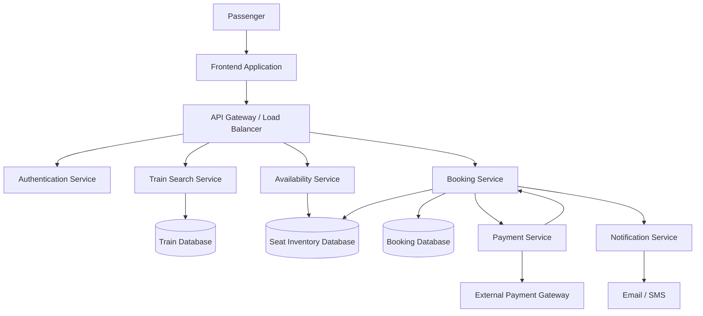

# How Online Railway Reservation Systems Handle Millions of Booking Requests

## 1. Introduction

Online railway reservation systems allow passengers to search for trains, check seat availability, book tickets, make payments, and receive booking confirmations.

When thousands or even lakhs of passengers access the platform simultaneously, especially during Tatkal booking, the backend must handle enormous traffic while maintaining accurate seat availability.

While exploring the engineering behind IRCTC's website upgrade, I became interested in understanding the system design challenges involved in building reliable online railway reservation platforms.

The biggest challenge is not simply handling a large number of users. It is ensuring that the same seat is never confirmed for two different passengers for the same journey.

This technical case study explores how such a reservation system can be designed.

> **Note:** This is an educational exploration of a conceptual railway reservation architecture. It does not represent IRCTC's confirmed internal backend implementation.

## System Architecture


---

## 2. Understanding the Real-World Problem

Imagine a train with 500 available seats.

At the same time:
- Passenger A checks seat availability.
- Passenger B checks the same seat.
- Both passengers see the seat as available.
- Both attempt to book it simultaneously.

If the system does not properly control concurrent requests, both passengers might receive confirmation for the same seat.

This is known as the **double-booking problem**.

A railway reservation system must ensure:

- Accurate seat availability.
- No duplicate confirmed bookings.
- Reliable payment processing.
- Consistent booking information.
- Fast responses during peak traffic.
- Recovery from failed transactions.

---

## 3. Understanding Consistency

Consider two different applications.

### Example 1: Instagram Likes

Suppose I see 10 likes on a post while another user sees 15 likes.

This temporary difference may be acceptable because the data can synchronize later.

This is an example of a situation where eventual consistency may be acceptable.

### Example 2: Railway Seat Booking

Now imagine seat 42 in coach S4.

If two passengers see the same seat as available and both successfully book it, the system creates a serious conflict.

A confirmed seat must not be assigned to two passengers for the same journey.

This requires strong consistency in the critical reservation operation.

**Key takeaway:** Data such as social media engagement counts may tolerate temporary differences, but confirmed seat allocation requires strict protection against conflicting bookings.

---

## 4. How the Booking Process Works

A typical online railway reservation process involves the following steps:

1. Passenger searches for trains using source, destination and journey date.
2. Backend retrieves matching trains.
3. Passenger checks seat availability.
4. Passenger selects a class and available seat or berth.
5. System validates the latest inventory.
6. Passenger details are submitted.
7. Payment is initiated.
8. Booking is confirmed after the required validations and successful processing.
9. Passenger receives a booking confirmation and PNR details.

The important part is that availability displayed during search must be validated again when the booking is actually processed.

---

## 5. How the System Prevents Double Booking

The database must protect seat allocation when multiple users attempt to book the same seat.

A conceptual approach involves:

### A. Database Transactions

A transaction groups related database operations into a single logical operation.

For example:

- Check whether a seat is available.
- Reserve or allocate the seat.
- Create the booking record.
- Update inventory.

If an operation fails, the transaction can be rolled back where appropriate.

### B. Row-Level Locking

A database can lock a particular seat inventory record while a transaction processes it.

If another transaction attempts to modify the same record, it must wait or retry.

This prevents two transactions from simultaneously allocating the same inventory.

### C. Atomic Updates

An atomic conditional update can ensure that a seat is changed from AVAILABLE to RESERVED only if it is still available.

Illustrative SQL:

```sql
UPDATE seat_inventory
SET status = 'RESERVED'
WHERE seat_id = 42
AND journey_id = 1001
AND status = 'AVAILABLE';
```

The application checks the number of affected rows.

- One affected row: the reservation operation succeeded.
- Zero affected rows: the seat was no longer available.

This is an example of atomic inventory protection.

---

## 6. Understanding Seat Locking

Imagine Passenger A selects seat 42 and proceeds to payment.

The system may temporarily reserve the seat while payment is being completed.

A conceptual seat lifecycle:

```text
AVAILABLE
    |
    v
RESERVED
    |
    v
PAYMENT PROCESSING
    |
    +------> CONFIRMED
    |
    +------> FAILED / EXPIRED
                 |
                 v
              AVAILABLE
```

A temporary reservation should have an expiry time.

For example:

- Passenger selects a seat.
- System temporarily reserves it.
- Passenger completes payment within the allowed time.
- Booking becomes confirmed.
- If payment or booking processing fails, the reservation is released according to the recovery rules.

**Important:** Payment processing and seat allocation must be coordinated carefully. A payment success response alone should not blindly create a second booking or cause an already allocated seat to be reassigned.

---

## 7. Why Tatkal Booking Is Challenging

Tatkal booking creates a sudden increase in traffic.

At the opening time, many passengers may attempt to reserve a limited number of seats simultaneously.

Consider this hypothetical situation:

| Metric | Example |
|---|---:|
| Users attempting booking | 100,000 |
| Available seats | 2,000 |
| Concurrent requests | Very high |
| Booking demand | Much higher than supply |

These numbers are illustrative, not actual IRCTC statistics.

The system must:

- Accept and process large numbers of requests.
- Prevent duplicate seat allocation.
- Manage database contention.
- Handle payment failures.
- Avoid unnecessary repeated requests.
- Maintain acceptable response times.

The challenge is not just processing requests quickly. It is processing them correctly.

---

## 8. High-Level System Architecture

The following is a conceptual architecture for an online railway reservation platform.

### Architecture Components

**1. Frontend Application**

Provides the interface for:
- User registration and login.
- Train search.
- Seat availability.
- Passenger details.
- Payment and booking status.

**2. API Gateway / Load Balancer**

Receives incoming requests and distributes traffic across backend application instances.

**3. Authentication Service**

Validates user identity and manages authentication.

**4. Train Search Service**

Retrieves train information based on source, destination and journey date.

**5. Availability Service**

Retrieves current seat inventory and availability information.

**6. Booking Service**

Handles booking requests and coordinates the reservation workflow.

**7. Database**

Stores:
- Train details.
- Routes and schedules.
- Seat inventory.
- Passenger information.
- Booking records.
- Payment references.

**8. Payment Service**

Coordinates payment requests with an external payment gateway.

**9. Notification Service**

Sends booking confirmation, cancellation and payment-related notifications.

### Conceptual Architecture Diagram



This diagram represents a proposed design, not a verified diagram of IRCTC's internal architecture.

---

## 9. Handling Payment Failures

Payment processing introduces another important engineering challenge.

Consider this situation:

1. Passenger selects a seat.
2. The system temporarily reserves it.
3. Payment is initiated.
4. The payment gateway processes the transaction.
5. The application does not receive a response because of a network failure.

The application cannot simply assume that payment failed.

It should verify the payment status with the payment provider and safely handle retries.

### Important Concepts

- **Idempotency:** Prevents duplicate processing when the same request is retried.
- **Payment verification:** Confirms the actual payment result.
- **Timeout handling:** Handles requests that take too long.
- **Compensation:** Corrects or reverses completed operations when a later step fails.
- **Reconciliation:** Compares booking and payment records to identify mismatches.

For example, an idempotency key can help ensure that retrying the same payment request does not create duplicate payment operations.

---

## 10. Managing High Traffic

During peak booking periods, the application must support many simultaneous users.

Some commonly used system-design techniques include:

| Technique | Purpose |
|---|---|
| Load balancing | Distributes requests across application servers |
| Horizontal scaling | Adds more application instances |
| Caching | Reduces repeated database reads |
| Message queues | Processes suitable background tasks asynchronously |
| Database indexing | Improves query performance |
| Connection pooling | Reuses database connections |
| Rate limiting | Controls excessive incoming requests |

One important distinction is that caching can improve read performance, but the final seat allocation must always be validated against the authoritative inventory.

A cached availability result should never be treated as the final booking confirmation.

---

## 11. Important Engineering Challenges

### A. Concurrent Requests

Multiple users may attempt to book the same seat at the same time.

**Solution concepts:** Transactions, row-level locking and atomic conditional updates.

### B. Database Bottlenecks

A large number of simultaneous requests may increase database contention.

**Solution concepts:** Query optimization, indexing, connection pooling and carefully designed inventory operations.

### C. Payment Failures

Payment may succeed even when the application does not receive the response.

**Solution concepts:** Idempotency, payment verification and reconciliation.

### D. Network Failures

A passenger may lose connectivity while a booking is being processed.

**Solution concepts:** Request tracking, safe retries and reliable booking-status retrieval.

### E. Sudden Traffic Spikes

Tatkal opening times can produce a large increase in incoming traffic.

**Solution concepts:** Load balancing, horizontal scaling, rate limiting and queue-based processing where appropriate.

---

## 12. Technologies and Concepts Worth Understanding

The following technologies and concepts are relevant to designing this type of system.

| Technology / Concept | Role |
|---|---|
| Java / Spring Boot | Backend application development |
| REST APIs | Communication between frontend and backend |
| MySQL / PostgreSQL | Relational data storage |
| Redis | Caching and selected temporary data |
| Apache Kafka | Event streaming and asynchronous processing |
| RabbitMQ | Message-based communication |
| Docker | Application containerization |
| Kubernetes | Container orchestration |
| Nginx | Reverse proxy and load balancing |
| Database Transactions | Reliable multi-step database operations |

These are possible technologies for a conceptual design. This list does not claim that IRCTC uses all of them.

---

## 13. Key Learnings

Exploring railway reservation system design helped me understand several important backend engineering concepts:

1. Why strong consistency matters in seat reservation.
2. How concurrent requests can create data conflicts.
3. Why database transactions are important.
4. How atomic updates help prevent double booking.
5. Why payment processing requires idempotency.
6. How load balancing and horizontal scaling help handle traffic.
7. Why a reliable backend is essential for a smooth user experience.

A good booking system is not just about displaying available seats. It must ensure that the final reservation is accurate, reliable and protected against conflicting requests.

---

## 14. Conclusion

A railway reservation platform is a practical example of how distributed systems, database management, concurrency control and backend engineering work together.

The user sees a simple process: search for a train, select a seat and book a ticket.

Behind that experience, the system must coordinate multiple services, handle simultaneous requests, protect seat inventory and recover from failures.

This exploration helped me appreciate the engineering decisions behind applications that millions of people depend on.

I look forward to exploring more real-world system design concepts and documenting what I learn through **BehindTheTech**.

---

## 15. References and Further Reading

- [IRCTC Official Website](https://www.irctc.co.in/)
- [MySQL Documentation – InnoDB Transaction Model](https://dev.mysql.com/doc/refman/8.0/en/innodb-transaction-model.html)
- [MySQL Documentation – InnoDB Locking](https://dev.mysql.com/doc/refman/8.0/en/innodb-locking.html)
- [PostgreSQL Documentation – Transaction Isolation](https://www.postgresql.org/docs/current/transaction-iso.html)
- [Apache Kafka Documentation](https://kafka.apache.org/documentation/)
- [Redis Documentation](https://redis.io/docs/latest/)

---

**Disclaimer:** This document is an independent educational exploration of railway reservation system design. The architecture, workflows, examples and technology choices are conceptual and are not claims about IRCTC's proprietary implementation or confirmed features of its website upgrade.
