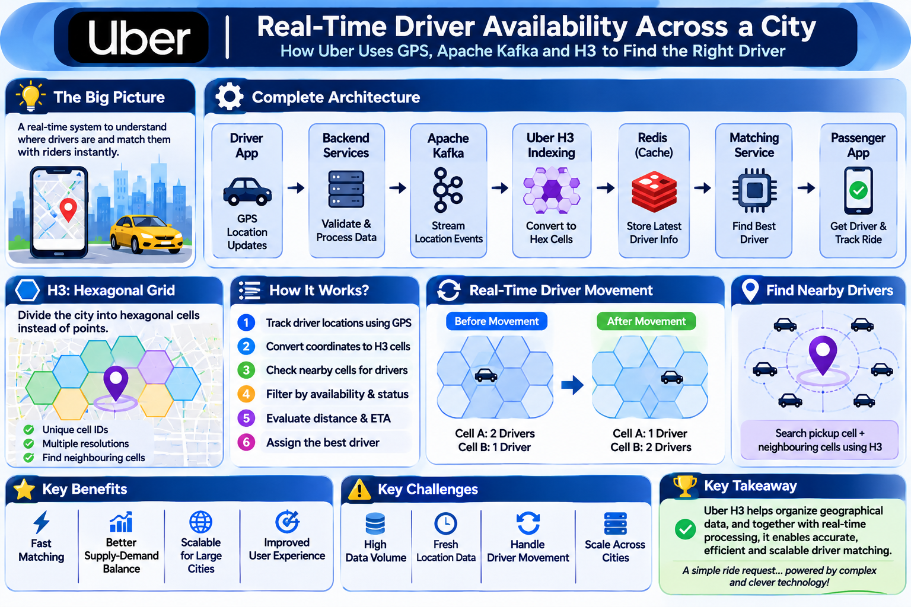
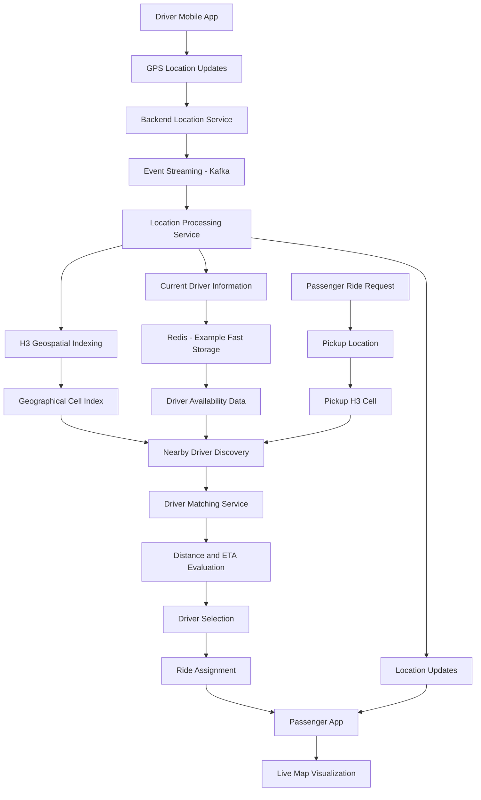

# How Uber Understands Driver Availability Across Different Geographical Areas in Real Time

## 1. Introduction

While exploring different technologies and software engineering concepts, I came across an interesting question:

**How does Uber understand the availability of drivers across different geographical areas in real time?**

Imagine a concert ends, and thousands of people start booking cabs simultaneously.

Drivers are spread across different locations:
- Some drivers are waiting for ride requests.
- Some are already completing trips.
- Some are moving towards passengers.
- Some are travelling through different parts of the city.
- Some may become available within the next few minutes.

Now imagine Uber having to understand all this continuously changing information and identify suitable drivers whenever a passenger requests a ride.

This raises several interesting engineering questions:

- How does Uber receive driver location updates?
- How does it know where drivers are currently located?
- How does it understand how many drivers are available in each area?
- How can it identify nearby drivers quickly?
- How does it match a passenger with a suitable driver?
- How can the system handle thousands of simultaneous ride requests?

While exploring these questions, I came across an interesting technology developed by Uber: **H3 – Hexagonal Hierarchical Geospatial Indexing System.**

This documentation explores the concepts and technologies that can be used to understand how a large-scale, real-time ride-hailing platform works.

## System Architecture

The following diagram illustrates a conceptual architecture
for understanding real-time driver availability using GPS,
geospatial indexing, event streaming, and driver matching.



---

## 2. Understanding the Real-World Problem

Let's take a simple example.

Imagine a city divided into different geographical areas.

At a particular moment:

| Area | Total Drivers | Available Drivers | Busy Drivers |
|---|---:|---:|---:|
| Area A | 20 | 12 | 8 |
| Area B | 15 | 5 | 10 |
| Area C | 10 | 8 | 2 |
| Area D | 25 | 4 | 21 |

These numbers are only hypothetical examples.

From this information, the platform can understand that:

- Area A has a reasonable number of available drivers.
- Area B has fewer available drivers.
- Area C has more available drivers compared to its demand.
- Area D has many drivers, but most are currently busy.

However, driver availability is not permanent.

A driver can accept a ride, complete a trip, move into another area or go offline.

Therefore, the platform needs to process continuous updates instead of depending on a fixed list of drivers.

**The main challenge is maintaining an up-to-date understanding of driver locations and availability across the city.**

---

## 3. How Does Uber Know a Driver's Location?

The first important concept is GPS-based location tracking.

A driver's mobile application can obtain geographical coordinates using the device's location services.

A geographical coordinate contains two important values:

- Latitude: Represents the north-south position.
- Longitude: Represents the east-west position.

For example:

```text
Driver ID: D101
Latitude: 17.3850
Longitude: 78.4867
Status: Available
```

These coordinates represent the driver's geographical position.

When the driver moves, the application can send updated location information to backend services.

A simplified location update might contain:

```json
{
  "driverId": "D101",
  "latitude": 17.3850,
  "longitude": 78.4867,
  "status": "AVAILABLE",
  "timestamp": "2026-11-08T10:30:00Z"
}
```

The backend processes these updates to maintain a current understanding of the driver's location and status.

### Why are timestamps important?

Imagine a driver sends a location update at 10:30 AM.

At 10:31 AM, another update arrives.

The backend should use the latest valid update rather than accidentally replacing it with an older update that arrives late.

Timestamps help the system reason about data freshness and update ordering.

**Important:** GPS coordinates tell the system where a driver is located. They do not independently tell the system whether that driver can accept a new ride.

---

## 4. Understanding Driver Availability

Location and availability are two different things.

A driver can be physically near a passenger but still be unavailable.

For example:

| Driver | Location | Status |
|---|---|---|
| D101 | Area A | Available |
| D102 | Area A | On Trip |
| D103 | Area B | Available |
| D104 | Area B | Offline |
| D105 | Area C | Accepted a Ride |

A simplified driver status model could contain:

1. **Available:** Driver can receive a new ride request.
2. **On Trip:** Driver is currently completing a ride.
3. **Ride Accepted:** Driver has accepted a request.
4. **Offline:** Driver is not participating in the active marketplace.
5. **Temporarily Unavailable:** Driver cannot currently accept another request.

The actual state model of a production ride-hailing platform can be more detailed.

### Why is this important?

Suppose five drivers are located near a passenger.

However:
- Two are completing trips.
- One has already accepted another ride.
- One is offline.
- Only one is available.

Simply finding nearby drivers is not enough.

The platform also needs to understand their current availability.

---

## 5. What Is Uber H3?

While exploring Uber's engineering technology, I came across H3.

**H3 stands for Hexagonal Hierarchical Geospatial Indexing System.**

Uber developed and open-sourced H3 in 2018.

It divides the Earth's surface into a global grid of hexagonal cells and assigns a unique index to each cell.

Instead of working with every geographical coordinate independently, applications can organize location-based information using these cells.

### Understanding H3 with a simple example

Imagine dividing a city map into hexagonal areas.

```text
        _______       _______
       /       \     /       \
      / Cell A  \___/ Cell B  \
      \         /   \         /
       \_______/     \_______/

          _______       _______
         /       \     /       \
        / Cell C  \___/ Cell D  \
        \         /   \         /
         \_______/     \_______/
```

Each cell has a unique H3 index.

For example:

```text
Cell A → H3 Index A
Cell B → H3 Index B
Cell C → H3 Index C
Cell D → H3 Index D
```

When a geographical coordinate is converted into an H3 index, the system can identify which hexagonal cell contains that location.

### What makes H3 useful?

- Organizes geographical information into cells.
- Helps group location-based events.
- Supports neighbouring-cell operations.
- Supports multiple geographical resolutions.
- Helps analyse geographical patterns across large areas.

### Understanding H3 Resolution

H3 supports 16 resolutions, from resolution 0 to resolution 15.

A lower resolution represents larger geographical cells.

A higher resolution represents smaller geographical cells.

For example:

- Lower resolution: Useful for analysing larger geographical regions.
- Higher resolution: Useful for more detailed geographical analysis.

This hierarchical structure allows geographical data to be examined at different levels.

**Important:** H3 organizes geographical locations. It does not independently track drivers, determine availability or assign rides.

---

## 6. How Can H3 Help Understand Driver Distribution?

Let's consider a hypothetical city with three H3 cells.

Initially:

| H3 Cell | Drivers Present |
|---|---:|
| Cell A | 20 |
| Cell B | 15 |
| Cell C | 8 |

Suppose the platform receives location updates from drivers.

Each driver's latitude and longitude can be converted into an H3 cell index.

The system can then group location information according to geographical cells.

For example:

```text
Driver D101 → Cell A
Driver D102 → Cell A
Driver D103 → Cell B
Driver D104 → Cell C
```

The application can use this geographical grouping to calculate useful information, such as:

- Number of drivers in an area.
- Number of available drivers.
- Number of ongoing trips.
- Ride requests originating in an area.
- Areas with relatively high or low driver supply.

This helps analyse the marketplace geographically.

Uber's engineering article explains how H3 is used to bucket marketplace events into hexagonal areas and analyse supply, demand and dynamic pricing.

---

## 7. What Happens When a Driver Moves?

Now let's understand how geographical distribution changes.

Suppose Driver D101 moves from Cell A to Cell B.

### Before movement

```text
Cell A → 2 drivers
Cell B → 1 driver
```

### Driver movement

```text
Driver D101

Cell A  ──────────────►  Cell B
```

### After movement

```text
Cell A → 1 driver
Cell B → 2 drivers
```

The system must update the driver's latest geographical assignment.

It should not simply add one driver to Cell B for every incoming GPS update.

Instead, it needs to maintain the driver's current state and correctly handle repeated updates.

### Important considerations

**1. Latest location**

The latest valid location update should be used.

**2. Cell transition**

When a driver moves into another H3 cell, the system should update the geographical assignment.

**3. Duplicate updates**

Repeated messages should not cause the same driver to be counted multiple times.

**4. Stale location**

If a driver stops sending location updates, the system should avoid treating an old location as permanently current.

**5. Availability changes**

When a driver accepts a ride, the availability information must also be updated.

These are important considerations when designing real-time location systems.

---

## 8. Technologies That Can Work Together

Now let's connect the concepts with backend technologies.

The following is an illustrative architecture for understanding a large-scale real-time driver-location platform.

### 8.1 GPS – Location Tracking

**Purpose:** Capture the driver's geographical position.

The mobile application obtains latitude and longitude through device location services.

Location updates are sent to backend services.

### 8.2 Backend Location Service

**Purpose:** Receive and process location updates.

The backend can:

- Authenticate the driver.
- Validate incoming coordinates.
- Check timestamps.
- Process location updates.
- Maintain the latest driver location.

A location service acts as an entry point for incoming location information.

### 8.3 Apache Kafka – Event Streaming

**Purpose:** Handle continuous streams of location events.

Imagine thousands of drivers sending location updates.

Processing every update directly inside one service can create a heavy workload.

An event-streaming platform such as Apache Kafka can help distribute incoming events to different consumers.

For example:

```text
Driver Location Updates
          |
          v
     Location API
          |
          v
       Kafka
          |
     +----+----+
     |         |
     v         v
 Location   Analytics
 Processor  Consumer
```

A location-processing consumer can process updates to maintain current driver information.

An analytics consumer can process geographical data for reporting and marketplace analysis.

Kafka is used here as an example of an event-streaming technology, not as a confirmed component of Uber's exact current driver-location pipeline.

### 8.4 Uber H3 – Geospatial Indexing

**Purpose:** Organize geographical information.

The location processor can convert latitude and longitude into H3 indexes.

Example:

```text
Latitude + Longitude
          |
          v
      H3 Library
          |
          v
      H3 Index
          |
          v
     Geographical Cell
```

This makes it possible to group geographical information by cell.

### 8.5 Redis – Fast Data Access

**Purpose:** Maintain frequently accessed, changing information.

In an illustrative architecture, Redis could be used to store current driver information for quick access.

For example:

```text
Key: driver:D101

Value:
{
  "latitude": 17.3850,
  "longitude": 78.4867,
  "h3Cell": "Cell-A",
  "status": "AVAILABLE",
  "lastUpdated": "10:30 AM"
}
```

A separate geographical index could help retrieve candidate drivers associated with particular cells.

Redis is useful for low-latency data access, but the actual data structures, persistence strategy and consistency rules depend on the system design.

### 8.6 Driver Matching Service

**Purpose:** Evaluate potential drivers for a ride request.

When a passenger requests a ride, the matching service can use geographical information to identify candidate drivers.

It can then evaluate:

- Driver availability.
- Distance from the pickup location.
- Estimated arrival time.
- Vehicle category.
- Other matching constraints.

The matching service is separate from H3.

H3 helps organize and identify geographical candidates. Matching logic decides which candidate is suitable.

### 8.7 ETA and Routing Services

**Purpose:** Estimate how long it may take a driver to reach the passenger.

Straight-line geographical distance is not always the actual travel distance.

For example, two locations may be close geographically but separated by:

- A river.
- A highway.
- Traffic congestion.
- Road restrictions.
- One-way streets.

Routing and ETA services can consider road-network information and traffic conditions to estimate arrival time.

---

## 9. What Happens When a Passenger Requests a Ride?

Let's understand the complete process using a simple example.

Imagine a passenger requests a ride from a location inside Cell B.

### Step 1: Passenger Requests a Ride

The passenger opens the application and selects a pickup location.

The pickup location is represented using latitude and longitude.

### Step 2: Pickup Location Is Converted into H3

The geographical coordinates are converted into an H3 cell index.

```text
Pickup Coordinates
        |
        v
     H3 Index
        |
        v
      Cell B
```

### Step 3: Identify Nearby Geographical Cells

The system can identify the pickup cell and neighbouring cells.

This helps generate geographical areas in which candidate drivers may be located.

H3 provides neighbouring-cell operations for this purpose.

### Step 4: Retrieve Candidate Drivers

The application can retrieve driver records associated with the selected geographical cells.

For example:

```text
Cell B:
  D101
  D102

Cell C:
  D103
  D104

Cell D:
  D105
```

These are candidate drivers, not necessarily drivers who can accept the ride.

### Step 5: Filter by Availability

The matching service checks which candidates are currently eligible.

For example:

```text
D101 → Available
D102 → On Trip
D103 → Available
D104 → Offline
D105 → Available
```

The system removes candidates who are not eligible.

### Step 6: Evaluate Distance and ETA

The remaining candidates are evaluated using factors such as:

- Pickup distance.
- Estimated arrival time.
- Current availability.
- Vehicle category.
- Other business and matching rules.

### Step 7: Driver Selection and Ride Assignment

The matching process selects a suitable candidate.

A ride offer can be sent to the driver's application.

The assignment process must handle situations such as:

- Driver accepting the request.
- Driver rejecting the request.
- Driver not responding.
- Driver becoming unavailable.
- Another request being assigned first.

If the offer is not accepted, the system may need to evaluate another candidate.

### Step 8: Passenger Receives the Update

Once a driver is successfully assigned, the passenger application receives the relevant trip and driver information.

The passenger can then view the driver's location and estimated arrival time.

---

## 10. How Does the Map Show the Driver Moving in Real Time?

There are two related but different operations:

**1. Backend location processing**

The backend receives location updates and maintains the latest known driver location.

**2. Frontend map visualization**

The passenger application displays the driver's latest reported location on the map.

A simplified flow:

```text
Driver Mobile Application
          |
          v
    GPS Coordinates
          |
          v
    Backend Services
          |
          v
 Latest Driver Location
          |
          v
 Real-Time Communication
          |
          v
 Passenger Application
          |
          v
    Map Marker Update
```

The passenger's map marker can be updated as new location information arrives.

The frontend can also animate the marker between received positions to make movement appear smooth.

### Important distinction

H3 is not the technology that draws the moving car on the map.

H3 organizes geographical data into cells.

Map rendering, location communication and routing are separate responsibilities.

---

## 11. Understanding Supply and Demand Across a City

One of the interesting applications of H3 is analysing the geographical distribution of supply and demand.

Let's understand this with a hypothetical example.

| H3 Cell | Available Drivers | Ride Requests |
|---|---:|---:|
| Cell A | 20 | 8 |
| Cell B | 5 | 25 |
| Cell C | 15 | 6 |
| Cell D | 3 | 18 |

From this information:

- Cell A has more available drivers than ride requests.
- Cell B has relatively high demand and low driver supply.
- Cell C has relatively more driver supply.
- Cell D has relatively high demand compared with available drivers.

This information can help a marketplace understand where supply and demand are imbalanced.

Such insights can support operational decisions, marketplace forecasting and dynamic pricing.

Uber's H3 engineering article specifically describes bucketing marketplace events into hexagonal cells and analysing supply and demand geographically.

---

## 12. Complete Conceptual Architecture

The following diagram summarizes how the different components can work together.



**Note:** This is a conceptual architecture created for learning and system-design understanding. It is not an official diagram of Uber's proprietary internal architecture.

---

## 13. Important Engineering Challenges

Building a real-time location-based system involves more than receiving GPS coordinates.

Some important challenges include:

### 13.1 High Volume of Location Updates

Thousands of drivers may send location updates continuously.

The backend must handle a large number of incoming events.

### 13.2 Data Freshness

Old location information should not be treated as the driver's current location.

Timestamps and freshness checks help address this.

### 13.3 Duplicate Events

Repeated location updates should not create duplicate driver records.

### 13.4 Driver Movement Between Cells

When drivers cross geographical boundaries, their current cell assignment must be updated correctly.

### 13.5 Concurrent Ride Requests

Multiple passengers may request rides at nearly the same time.

The matching and assignment process must prevent the same driver from being assigned to conflicting trips.

### 13.6 Scalability

The platform must support location updates and ride requests across many cities and geographical regions.

### 13.7 Network Connectivity

Drivers may experience poor network connectivity.

The backend must account for delayed or missing location updates.

---

## 14. Key Technologies and Their Responsibilities

| Technology | Responsibility |
|---|---|
| GPS | Captures geographical coordinates |
| Backend Services | Receives and processes updates |
| Apache Kafka | Example event-streaming platform |
| Uber H3 | Converts coordinates into geographical cell indexes |
| Redis | Example fast-access data store |
| Matching Service | Evaluates candidate drivers |
| Routing / ETA | Estimates travel time |
| WebSocket or Other Real-Time Transport | Delivers updates to connected applications |
| Map SDK | Displays locations on the map |

These technologies solve different problems. They should not be treated as interchangeable components.

---

## 15. What I Learned From Exploring This Concept

Initially, I thought that real-time location tracking was simply about collecting GPS coordinates and displaying moving vehicles on a map.

But exploring this concept introduced me to a much broader engineering perspective.

I learned how different technical concepts can work together:

- GPS-based location tracking.
- Real-time event processing.
- Geospatial indexing.
- Hexagonal geographical grids.
- Driver availability management.
- Event streaming.
- Low-latency data access.
- Nearby-driver discovery.
- Driver matching.
- ETA and routing.
- Supply and demand analysis.
- Scalable backend architecture.

One concept that particularly interested me was Uber H3.

It showed me how geographical data can be organized using hexagonal cells instead of analysing every location as an isolated point.

**My biggest takeaway:**

A feature that looks simple from the user's perspective, such as finding a nearby cab, can involve several interesting engineering problems working together behind the scenes.

As a fresher, exploring how companies like Uber approach real-world engineering challenges helps me connect the technologies I learn with practical system-design concepts.

---

## 16. References and Further Reading

The following are official resources used to explore this topic.

### 1. Uber Engineering – H3: Uber's Hexagonal Hierarchical Spatial Index

https://www.uber.com/blog/h3/

Explains why Uber developed H3, how hexagonal indexing works and how geographical data can be analysed across a marketplace.

### 2. H3 Official Documentation

https://h3geo.org/docs/

Explains H3 concepts, cell indexes, resolutions, geographical operations and the H3 API.

### 3. H3 GitHub Repository

https://github.com/uber/h3

Official open-source implementation of the H3 geospatial indexing system.

### 4. Uber Engineering – Visualizing City Cores with H3

https://www.uber.com/blog/visualizing-city-cores-with-h3/

Explains how H3 can be used to analyse geographical patterns and understand city-level marketplace areas.

### 5. Uber Engineering – Reinforcement Learning for Modeling Marketplace Balance

https://www.uber.com/blog/reinforcement-learning-for-modeling-marketplace-balance/

Explores marketplace balance and matching challenges between drivers and ride demand.

---

## Disclaimer

This documentation is an educational exploration of real-time driver availability and geospatial indexing.

The H3 concepts are based on Uber's publicly available engineering resources. The Kafka, Redis, location-processing and matching-service flow is a simplified illustrative architecture to explain how such a system could be designed.

It should not be interpreted as a complete or verified description of Uber's proprietary production architecture.
